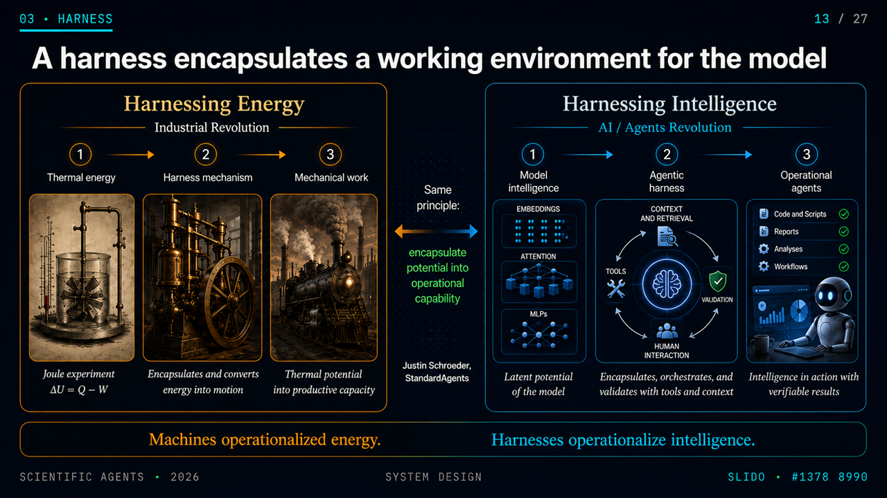

# Universal Agent Harness

> Meta-arquitetura versionada para configurar o menor harness robusto
> necessário para cada novo projeto assistido por IA. Legível por
> Codex e Claude Code sem duplicar o núcleo de regras
> entre plataformas.



## Para que serve

Este repositório é um **bootstrap de harness** — uma infraestrutura
reutilizável que você aponta para um projeto novo. Em vez de começar
cada projeto do zero, você aponta o agente para cá e o harness
propõe a configuração mínima suficiente para aquele projeto.

A arquitetura segue quatro camadas (Control, Knowledge, Execution,
Assurance) e três princípios inegociáveis: **invariantes, não
implementações**; **harness determinístico primeiro**; **fonte como
autoridade** (sources imutáveis, representações derivadas).

## Como usar em um projeto novo

**Caminho recomendado (v0.6.0): UAH-lite.** Instale a skill uma vez e
rode `/uah-init` no Claude Code dentro do projeto. Veja a seção
[UAH-lite](#uah-lite-v090--harness-executável-por-projeto) abaixo.

Caminhos declarativos anteriores (continuam válidos):

1. **Caminho mais leve** — referencie este repositório como
   submódulo Git ou clone fixado em `.harness/upstream` no seu
   projeto. Registre o commit exato em `harness.lock.yaml`.
2. **Caminho pela skill** — peça ao agente para carregar a skill
   `classify-project` (em `skills/classify-project/SKILL.md`).
   Ela faz 15 perguntas e recomenda arquétipo, capacidades,
   contratos de ferramentas e sensores antes de qualquer
   Bootstrap Report.
3. **Caminho pelo bootstrap** — use `bootstrap/NEW-PROJECT.md`
   como prompt inicial do Codex ou do Claude Code. Ele
   executará o protocolo em `bootstrap/BOOTSTRAP.md` em modo
   dry-run e produzirá o Bootstrap Report.

Todos os caminhos terminam em `APPROVE`, `REVISE` ou `BLOCK`
antes de qualquer modificação no projeto de destino.

## UAH-lite (v0.9.0) — harness executável por projeto

O UAH-lite é a parte executável do UAH. Ele **não orquestra**: entrevista e
planejamento ficam com o [Oh My ClaudeCode (OMC)](https://github.com/Yeachan-Heo/oh-my-claudecode),
execução com o Claude Code. Ele cuida só do que nenhum dos dois faz:

1. materializa o **mínimo** de arquivos por projeto;
2. **compila** as regras H0–H3 em `permissions` e hooks do Claude Code (o único
   ponto onde regras são aplicadas de fato, sem depender da boa vontade do modelo);
3. amarra a execução a um **plano aprovado por humano** (gate G1, vinculado ao hash do plano);
4. mantém o **estado de retomada** no repositório (gate G4), para outra sessão,
   conta ou máquina continuar o trabalho.

### Requisitos

| Componente | Papel | Obrigatório? |
|---|---|---|
| [Claude Code](https://docs.claude.com/en/docs/claude-code/overview) | interface e execução; seus hooks aplicam as regras | sim |
| Python 3.10+ e PyYAML | `uah.py` (o hook usa só a biblioteca padrão) | sim |
| git (+ remoto) | estado canônico e retomada entre máquinas | recomendado |
| [OMC](https://github.com/Yeachan-Heo/oh-my-claudecode) | `deep-interview` e `plan`/`ralplan` quando o objetivo é ambíguo ou grande; `omc capabilities` fixa a versão | recomendado |
| [Workflow_Digestion](https://github.com/fatioleg/Workflow_Digestion) | documentos → corpus → grafo → vault do Obsidian | integração opcional |
| [specboard](https://github.com/fatioleg/specboard) | painel de validação de módulos (executado ≠ verificado) | integração opcional |
| [CalcBoard](https://github.com/fatioleg/CalcBoard) | painel dos cálculos (ORCA, CP2K, VASP, Gaussian, QE, ASE) | integração opcional |
| [publish-documents](https://github.com/fatioleg/publish-documents) | PDF/DOCX profissional a partir de Quarto (Typst, LaTeX, Word técnico ou ABNT) | integração opcional |
| [sci-figures](https://github.com/fatioleg/sci-figures) | figuras de publicação por especificação (RDKit, ASE, D2, matplotlib) | integração opcional |
| [ai-memory](https://github.com/akitaonrails/ai-memory) | memória entre sessões/agentes | opcional, não integrado ainda |

### Instalação do zero (uma vez por máquina)

```bash
git clone https://github.com/fatioleg/Universal-Agent-Harness.git
cd Universal-Agent-Harness
python3 -c "import yaml" || sudo apt install python3-yaml   # PyYAML: único requisito Python do uah.py
python3 skills/uah-init/uah.py setup-env --integrations all            # relatório: o que existe e o que falta
python3 skills/uah-init/uah.py setup-env --integrations all --install  # instala o que dá sem sudo
```

O que o `setup-env --install` faz sozinho, **sem `sudo`**, tudo no seu usuário:

| Item | Como |
|---|---|
| skill `uah-init` | liga `~/.claude/skills/uah-init` ao clone |
| skills do catálogo (specboard, CalcBoard, Workflow_Digestion, publish-documents, sci-figures) | clona cada repositório **no commit fixado** do catálogo e liga a skill |
| Quarto 1.10.19 (publish-documents) e D2 0.9.0 (sci-figures) | baixa a versão fixa, **confere o SHA-256** no arquivo de checksums do projeto, extrai em `~/.local/opt` e liga em `~/.local/bin` |
| ambiente Python do sci-figures (RDKit, ASE, matplotlib, cairosvg) | roda `figs.py setup` |

O que ele só **explica**, com o comando exato, porque exige outra ferramenta ou `sudo`:

| Item | Por quê | Comando indicado |
|---|---|---|
| OMC | é plugin do Claude Code | `/plugin marketplace add https://github.com/Yeachan-Heo/oh-my-claudecode`, `/plugin install oh-my-claudecode`, `/omc-setup` |
| molar_vis (`molecule-3d`, opcional) | precisa de Rust e compilação | `git clone https://github.com/yesint/molar_vis` + `maturin develop --release` no venv do sci-figures |
| XeLaTeX, LibreOffice, poppler, librsvg | pacotes do sistema | `sudo apt install texlive-xetex texlive-lang-portuguese libreoffice-writer poppler-utils librsvg2-bin` (só os que faltarem) |

Sem `--integrations`, o `setup-env` usa as integrações ativas no `project.yaml` do projeto atual. Dentro de um
projeto com o UAH, `setup-env --install` pede confirmação humana, como toda instalação. Garanta que
`~/.local/bin` esteja no `PATH`; o relatório avisa se não estiver.

### Fluxo

```text
/uah-init no Claude Code (dentro do projeto)
   │
   ▼
G0 · Descoberta (só leitura)
   │   se já existe .uah/ → preflight, resume o estado e para
   ▼
Escolha do risco (confirmada pelo usuário)
   │   low    → sem gate de plano
   │   medium → gate G1 (padrão)
   │   high   → gate G1 + checkpoint G4 obrigatório + confirmação extra
   ▼
uah.py init --domains …
   │   cria: CLAUDE.md/AGENTS.md (bloco UAH), project.yaml,
   │         plan/approved.md (rascunho), state/current.md
   │   instala: .uah/ (uah.py, guarda, perfis) e .claude/settings.json (hooks)
   │   registra: versões do Claude Code e do OMC + omc capabilities lock
   ▼
Integrações (opcionais, sugeridas pelos domínios do projeto)
   │   uah.py integrations → enable / install (com confirmação humana)
   ▼
[workflow-digestion] muitos documentos-fonte? → corpus → grafo → Obsidian
   ▼
Plano
   │   objetivo pequeno e claro → o Claude escreve o plano direto
   │   ambíguo ou grande → OMC deep-interview e/ou plan
   │                       → uah.py import-plan .omc/plans/x.md
   │   [specboard] projeto modular → painel de módulos e contratos para revisar
   ▼
G1 · Aprovação humana
   │   uah.py approve → o guarda pede confirmação → grava o sha256 do plano
   │   editar o corpo do plano depois reabre o gate
   │   projeto incremental? cada fatia: omc-plan → import-plan --slice N
   │                                   → approve --slice N (só a fatia ativa libera execução)
   ▼
Execução (Claude Code / OMC, normalmente)
   │   a cada ação o hook-guarda decide: bloquear / pedir confirmação / liberar
   │   [specboard] etapas → executado + evidência; humano faz review/verify
   │   [calcboard] cálculos → painel como evidência antes de aceitar resultado
   ▼
G4 · Checkpoint
   │   uah.py checkpoint --task T-001 --status paused --next "..."
   │   (em risco alto, o hook Stop não deixa encerrar sem isso)
   ▼
Retomada (outra sessão, conta ou máquina)
       hook SessionStart injeta: plano aprovado?, tarefa, próxima ação, bloqueios
       uah.py preflight confere política, hooks, plano, git e superfície do OMC
```

### Comandos

Antes do `init`, use `python3 ~/.claude/skills/uah-init/uah.py`; depois,
a cópia fixada no projeto, `python3 .uah/uah.py`. Na sessão, `/uah-init`
conduz tudo isso por você.

| Comando | O que faz |
|---|---|
| `init --risk low\|medium\|high [--title …] [--domains …] [--integrations …] [--python python]` | cria/atualiza os arquivos mínimos e o runtime `.uah/` (idempotente; preserva conteúdo existente) |
| `compile` | resolve H0+H1+H2+H3 → `.uah/policy.json` + `.claude/settings.json` |
| `import-plan <arquivo>` | traz plano/spec do OMC para `plan/approved.md` (status draft; troca a home por `~`) |
| `approve [--by nome]` | aprova a revisão atual do plano (exige escopo e critério de aceite) |
| `task --id T-xxx [--grant id --hours N] [--clear]` | contexto H3 da tarefa; concessão temporária só das listadas em `grantable` |
| `checkpoint --task … --status … --next "…" [--blocker …]` | atualiza `state/current.md` com commit, revisão do plano e próxima ação |
| `preflight` / `status` | verifica política, hooks, plano, estado, git, versões e integrações; `FAIL` sai com código 1 |
| `explain` | mostra as regras efetivas em linguagem simples, com a camada de origem de cada uma |
| `integrations [list]` | lista o catálogo, mostrando o que está ativo e instalado e o que é recomendado para o projeto |
| `integrations install <id>` | clona o repositório em `~/.claude/tools/` e liga a skill em `~/.claude/skills/` |
| `setup-env [--integrations ids\|all] [--install]` | relatório da máquina; com `--install`, instala sem sudo (skills fixadas, Quarto, D2, venv) e explica OMC, molar_vis e pacotes de sistema |
| `integrations enable\|disable <id>` | ativa/desativa no `project.yaml` (preserva comentários) e recompila |
| `import-plan <arquivo> --slice N` / `approve --slice N` | traz e aprova uma fatia de MVP (a aprovada fica ativa) |
| `slice [list\|new N\|activate N\|done N]` | gerencia as fatias; `done` fecha o gate até a próxima |

### Arquivos em cada projeto

| Arquivo | Papel |
|---|---|
| `CLAUDE.md` / `AGENTS.md` | entrypoint curto (bloco `UAH:BEGIN…END`; o resto do arquivo é preservado) |
| `project.yaml` | H2: identidade, risco e regras do projeto (editar pede confirmação) |
| `plan/approved.md` | plano; o hash do corpo é a revisão aprovada |
| `state/current.md` | estado de retomada (tarefa, status, próxima ação, commit) |
| `.uah/` | runtime fixado: `uah.py`, `hooks/uah_guard.py`, perfis, `policy.json`, `plan.lock.json`, versões (imutável para o agente) |
| `.claude/settings.json` | `permissions` + hooks `PreToolUse`, `SessionStart` (e `Stop` em risco alto); configurações suas são preservadas |

Faça commit de tudo, inclusive `.uah/`. **Não** versione `.omc/` (pode conter transcripts).

### Integrações: suas ferramentas no fluxo, só quando necessário

O UAH-lite mantém um catálogo (`skills/uah-init/integrations/*.json`) com repositório, etapa do fluxo,
quando usar e quando não usar, requisitos e regras extras. Uma integração só vale num projeto quando
listada em `project.yaml → integrations`. A instalação é detectada, nunca presumida.

| Integração | Etapa | Use quando | Regras que acrescenta |
|---|---|---|---|
| [**Workflow_Digestion**](https://github.com/fatioleg/Workflow_Digestion) | descoberta | há uma pasta com muitos PDFs/DOCX/PPTX a transformar em corpus, grafo de conhecimento e vault do Obsidian (revisão de literatura, edital, base de conhecimento) | `graphify` pede confirmação (alto custo de tokens) |
| [**specboard**](https://github.com/fatioleg/specboard) | entre o plano e a aprovação; execução | projeto modular em risco medium/high: módulos, contratos pré-registrados, fila do que o humano precisa conferir | `review`/`verify` só pelo humano; `verificacoes.jsonl` imutável; `.specboard/**` e a CLI de planejamento liberados antes da aprovação |
| [**CalcBoard**](https://github.com/fatioleg/CalcBoard) | execução e validação | há saídas de cálculo (ORCA, CP2K, VASP, Gaussian, QE, ASE) a acompanhar e validar | `painel.py ler` liberado antes da aprovação |
| [**publish-documents**](https://github.com/fatioleg/publish-documents) | execução e entrega | o entregável é um relatório, artigo, parecer ou proposta em PDF/DOCX: fonte única Quarto, perfis `report-visual` (Typst), `journal-scientific` (LaTeX), `word-editable` (DOCX técnico ou ABNT), com preflight, verificação e inspeção visual | instalar extensões/templates (`quarto install/add/use`, `tlmgr`) pede confirmação; `preflight`/`doctor` liberados antes da aprovação |
| [**sci-figures**](https://github.com/fatioleg/sci-figures) | execução e entrega | o projeto precisa de figuras de publicação: moléculas 2D (RDKit), estruturas, cristais e superfícies (ASE), fluxogramas (D2) e gráficos de dados (matplotlib), cada uma com `fig.yaml`, manifesto de proveniência e verificação | `figs.py setup` (instala pacotes) pede confirmação; `figs.py doctor` liberado antes da aprovação |

```bash
python3 .uah/uah.py integrations                     # o que existe, o que está ativo e o que é recomendado
python3 .uah/uah.py integrations install calcboard   # instala a skill (pede confirmação)
python3 .uah/uah.py integrations enable calcboard    # ativa no projeto (pede confirmação)
```

As recomendações vêm de `project.domains` (ex.: `literatura`, `edital`, `quimica-computacional`,
`software`) e do risco. Para adicionar outra ferramenta, basta escrever um JSON novo no catálogo.

### Fatias de MVP: desenvolvimento incremental com SDD

Para projetos que avançam por incrementos: o **plano geral** (`plan/approved.md`) é aprovado uma vez e cada
**fatia** (`plan/slices/slice-N.md`) é planejada, aprovada e executada separadamente. Depois da primeira fatia,
nada material é feito sem uma fatia ativa e aprovada.

```text
/oh-my-claudecode:omc-plan --consensus "Crie .omc/plans/slice-N.md … (formato SDD: REQ, AC, fora do escopo,
                                          testes, critério de abandono, agente executor)"
python3 .uah/uah.py import-plan .omc/plans/slice-N.md --slice N
/specboard                                   # painel: a fatia vira módulo(s), contratos e etapas
python3 .uah/uah.py approve --slice N        # você aprova; a fatia fica ativa
… designer (UI) ou executor implementa · checkpoint · specboard build · você faz review/verify …
python3 .uah/uah.py slice done N             # fecha a fatia; o gate espera a próxima
```

O modelo completo do prompt do `omc-plan` está na `SKILL.md`. O `omc-plan` só planeja: painel e orquestração
ficam com o specboard e o UAH, e o `CLAUDE.md` continua curto.

### Nível de raciocínio, tentativas e custo (restrições, não um segundo orquestrador)

O OMC executa e escolhe os agentes. O UAH só impõe restrições, sem criar outra fila nem outro roteador:

- **Nível por tarefa** (`nível: leve | padrão | crítico` no plano e nas fatias), mapeado aos agentes do OMC, que já
  têm modelo fixo. `leve` usa ferramenta determinística primeiro e Haiku (`explore`/`writer`) só se preciso.
  `padrão` usa Sonnet (`executor`, `scientist`…) com `verifier`. `crítico` usa Opus (`analyst`/`architect`/`critic`)
  com revisão independente.
- **Parada por tentativas:** `checkpoint --failed "motivo"` conta as falhas da tarefa. No limite do risco (low 5,
  medium 3, high 2; o `project.yaml` só pode reduzir com `policy.max_attempts`), a tarefa fica bloqueada e o guarda
  nega alterações materiais até um humano decidir (`--reset-attempts`, com confirmação).
- **Custo por tarefa validada:** `checkpoint --status done --cost <USD do /cost> [--tokens N] --level …` grava em
  `state/tarefas.jsonl`. O `preflight` mostra as tarefas validadas, as tentativas médias e o custo médio por tarefa
  validada, a métrica que importa (um modelo barato que falha muito pode sair mais caro).

Não há limite rígido de tokens: nem o Claude Code nem o OMC oferecem um que o UAH possa aplicar. Por isso o controle
é por tentativas e o custo é registrado, não "orçado".

### O `project.yaml`

É a configuração do projeto (camada H2): identidade, domínios, risco, integrações e regras próprias
(`immutable_paths`, `protected_paths`, `settings_allow`, `grantable`…). Depois de editar, rode `compile`.
`explain` mostra o efeito em linguagem simples. Um campo com erro de digitação gera mensagem com sugestão
(ex.: `risc` → "quis dizer 'risk'?").

### Camadas H0–H3 (merge tipado, fail-closed)

- **H0** — invariantes universais: não apagar raiz/home, nada de `curl | sh`, sem force push;
  push, publicação, envio de dados e `sudo` pedem confirmação; aprovação é sempre humana.
- **H1** — perfil escolhido pelo risco (`low`, `medium`, `high`) + regras das integrações ativas (`INT-*`).
- **H2** — `project.yaml`: caminhos imutáveis/protegidos, regras extras, `settings_allow`, `grantable`.
- **H3** — `.uah/task.yaml`: restrições da tarefa e concessões temporárias (máx. 7 dias).

Camadas inferiores só **endurecem**. Afrouxar uma regra superior, `settings_allow`
amplo (ex.: `Bash(git:*)`), campo desconhecido ou regex inválida → `BLOQUEADO`, e nada é escrito.

### Como o hook-guarda decide (nesta ordem)

1. **Bloqueia** comando perigoso (H0 e regras do projeto).
2. **Bloqueia** escrita em caminho imutável (`.uah/`, `.git/`, `data/raw/`…), inclusive via redirecionamento com aspas, `sed -i`, `cd … &&`.
3. **Pede confirmação** para aprovar plano ou conceder permissão temporária.
4. **Bloqueia** alteração material se o plano não foi aprovado ou mudou (leitura e edição do plano seguem livres).
5. **Libera** comando coberto inteiro por concessão temporária válida.
6. **Pede confirmação** para push, publicação, envio de dados, `sudo` e arquivos protegidos.
7. Fora isso, não opina: vale o fluxo normal do Claude Code.

Erro interno no guarda vira bloqueio (fail-closed). As regras valem também para o comando como o shell o
executa (aspas e escapes que fragmentam palavras, como `g''it push`, não escapam), e as mais críticas são
compiladas ainda como permissões nativas do Claude Code. Com `.uah/policy.json` ausente, só os subcomandos de
bootstrap do `uah.py` (`compile`, `init`, `preflight`, `status`, `explain`) passam. Escrita fora do projeto pede
confirmação, exceto na área temporária do sistema. As CLIs de integração liberadas antes da aprovação precisam
estar dentro da skill instalada, com origem verificada pelo remoto git. Não basta o nome do arquivo.

### Quem faz o quê

| | Faz | Não faz |
|---|---|---|
| **Claude Code** | interface, execução, aplicação das regras via hooks | ser a fonte de verdade do projeto |
| **OMC** | entrevista e planejamento quando necessário | definir permissões ou estado canônico |
| **UAH-lite** | arquivos mínimos, compilação das regras, gate do plano, estado de retomada | orquestrar, entrevistar, memória própria, scheduler, banco vetorial |
| **Workflow_Digestion / specboard / CalcBoard / publish-documents / sci-figures** | digestão de documentos, painel de validação, painel de cálculos, publicação PDF/DOCX, figuras de publicação, quando ativos | entrar em projetos que não precisam deles |
| **ai-memory** | (futuro, opcional) recall entre sessões | substituir git, plano aprovado ou evidência |

**Fonte de verdade:** arquivos versionados > plano aprovado > memórias (Claude, OMC, ai-memory).

### Limites conhecidos

- A análise de Bash é heurística: protege contra deriva do agente, não contra um adversário (`python -c`, scripts não são inspecionados por dentro).
- Os hooks são do Claude Code; no Codex, o `AGENTS.md` e o estado são lidos, mas o enforcement depende do sandbox dele.
- Windows nativo: use `--python python`; alguns recursos do OMC são só Linux — prefira WSL2.

Mais detalhes: [`docs/uah-lite.md`](docs/uah-lite.md) · decisão: AD-014 em [`docs/DECISIONS.md`](docs/DECISIONS.md).

## Funcionalidades disponíveis para estruturar um harness otimizado

### Invariantes e princípios

- **12 invariantes travadas** em `core/invariants.yaml` — `locked`,
  não podem ser silenciosamente enfraquecidas.
- **9 princípios** em `core/principles/` — versão legível por
  humanos, com proveniência da fonte (OpenAI, Anthropic,
  Hashimoto, Böckeler).
- **Protocolo de override** em `core/policies/override-protocol.md`
  — quais princípios podem ser desviados, quais não, e o que
  registrar quando um desvio é necessário.

### Arquétipos de referência

Em `archetypes/` você encontra 11 padrões de workflow
documentados. **Atenção: são referência, não pacotes H1**.
Não são mesclados via `core/merge-policy.yaml` até que pelo
menos dois projetos reais justifiquem a promoção:

- `scientific-research` — investigação empírica, ledger de
  evidência pesado.
- `computational-science` — simulação e análise numérica,
  reprodutibilidade como núcleo.
- `computational-chemistry` — subset do anterior com sensores
  químicos (RDKit, pymatgen).
- `literature-review` — revisão sistemática, verificação de
  citação, PRISMA.
- `knowledge-base` — curadoria de longa duração, dedup e
  resolução de conflitos.
- `data-analysis` — análise de dataset, sensores estatísticos,
  manifest de execução.
- `software-development` — código-centrado, testes e linters
  como sensores primários.
- `document-production` — template-driven, validadores de
  formatação.
- `grant-project-proposal` — prazo + orçamento + sensores de
  conformidade do financiador.
- `full-sdd-project` — Spec-Driven Development completo:
  cinco specs (Charter, Requirements, Architecture, Validation,
  Deliverable), subagentes nomeados (Research, Domain Expert,
  Data Auditor, Implementation, QA, Red-Team), Context Packs,
  Subagent Reports, Handoffs, Issues, Decisions, Gates,
  Completion checklist. Veja `docs/sdd.md`.
- `knowledge-digestion` — pipeline canônica de ingestão
  `caveman → MarkItDown → Graphify → Obsidian → NotebookLM
  (opcional)`. Cada ferramenta é opt-in com papel definido.
  Veja `docs/knowledge-digestion.md`.

### Schemas de runtime

Em `core/schemas/extension/` você tem 8 schemas JSON Schema
draft 2020-12 para os artefatos que projetos podem instanciar:

- `state.schema.json` — o que está acontecendo agora.
- `evidence-ledger.schema.json` — claims com proveniência.
- `decisions.schema.json` — decisões com rationale.
- `tool-contract.schema.json` — contrato de ferramenta.
- `permission-profile.schema.json` — escopo por papel.
- `failure-registry.schema.json` — falhas com harness patch.
- `eval-result.schema.json` — resultado de eval.
- `observability-run.schema.json` — um registro por execução.

Schemas base (`project-input`, `resolved-harness`) ficam em
`schemas/` e são byte-idênticos desde v0.2.0.

### Topologia de agentes (Levels A–E)

Detalhado em `docs/agent-topology.md`. Cada nível adiciona custo
de coordenação; só escale quando houver justificativa registrada.

- **A** — agente único + ferramentas. Default.
- **B** — agente + revisor independente.
- **C** — orquestrador + um especialista.
- **D** — especialistas paralelos.
- **E** — equipe multiagente + verificação independente.

### Níveis de autonomia (L0–L5)

Detalhado em `docs/autonomy-levels.md`. Autonomia é por
capacidade e limitada por escopo, validadores, retries e
escalation. Default universal: baixo (L0–L1 em ações
materiais).

### Catálogo universal de evals

Em `evals/catalog.md`, 10 categorias de avaliação que qualquer
harness pode aplicar: retrieval, ingestão, extração, auditoria
numérica, verificação de citação, geração de artefato, handoff,
coordenação, resolução de conflitos, recuperação de falha.
Cada arquétipo seleciona seu subconjunto.

### Contratos de ferramentas (sem código)

Em `contracts/tools/` você tem 7 especificações YAML de
ferramentas que o agente pode invocar. **As implementações estão
adiadas para v0.4.0+** (AD-003, AD-010) até que pilotos reais
justifiquem. Os contratos informam ao agente quais capacidades
existem conceitualmente:

- `check-invariants` — verifica lock contra invariantes travadas.
- `diff-harness` — diff entre versões H0.
- `verify-artifact` — verificador genérico com perfil de sensor.
- `list-events` — leitura de log de eventos.
- `sensor-trend` — tendência de sensores (padrão Böckeler).
- `lock-drift-check` — drift entre commit fixado e upstream real.
- `scaffold-project` — geração de harness de projeto a partir
  de `project.yaml`.
- `caveman-compress` — comprimir slice recuperado ao budget
  de tokens.
- `markitdown-normalize` — converter PDF/DOCX/PPTX/XLSX/HTML/
  image para Markdown canônico.
- `graphify-build` — grafo de conhecimento com ponteiro de
  evidência em cada aresta.
- `obsidian-interface` — sincronizar canônico ↔ vault Obsidian.
- `notebooklm-explore` — análise externa via NotebookLM MCP
  (efêmero por default).

### Skill de classificação interativa

Em `skills/classify-project/`, uma skill que o agente carrega
quando você pede para começar um projeto novo. 15 perguntas em
5 grupos, com árvore de decisão e template de saída. Arquétipo,
capacidades, contratos, sensores, schemas, topologia e
autonomia ficam pré-configurados antes do Bootstrap Report.

### Spec-Driven Development (SDD)

SDD é o workflow estruturado para projetos complexos. Vive em
três lugares:

- **`docs/sdd.md`** — guia canônica do SDD no harness. Cobre
  cinco specs (Project Charter, Requirements, Architecture,
  Validation, Deliverable), Context Pack, Subagent Report,
  Handoff, Issues, Decisions, Gates (A–D), Definition of
  Done, change protocol, lista de proibições, e a regra
  "especificação é source of truth para intenção; código é
  source of truth para comportamento atual".

- **`archetypes/full-sdd-project.md`** — archetype opt-in para
  projetos que precisam da máquina completa: SDD workflow,
  seis subagentes nomeados (Research, Domain Expert, Data
  Auditor, Implementation, QA, Red-Team), persistent memory,
  handoffs estruturados, gates em sequência. Aciona a
  capability `sdd-workflow`.

- **`templates/project/`** — três templates novos para
  operacionalizar o SDD em um projeto:
  - `acceptance-criteria.template.md` — REQ→AC→Test→Impl
    com matriz de cobertura.
  - `test-cases.template.md` — pyramid mix + estrutura
    given/when/then.
  - `task-plan.template.md` — decomposição por tarefa com
    Definition of Done por task.

Schemas de extensão formalizam os identificadores:

- `acceptance-criterion.schema.json` (AC-NNNN-NN).
- `test-case.schema.json` (TEST-NNNN-NN com `pyramid_layer`).
- `change-request.schema.json` (CR-NNNN).

A regra de **proporcionalidade** vale: SDD completo só se
aplica a projetos médios / grandes / complexos. Projetos
triviais não precisam das cinco specs — uma página de charter
já basta.

### Disciplina de testes (TDD e test pyramid)

`docs/tdd.md` codifica a disciplina de testes com respaldo em
fontes primárias:

- **TDD red-green-refactor** (Kent Beck via Fowler).
- **Test pyramid** prático — unit, integration, contract,
  end-to-end, regression — com Ham Vocke no Fowler site.
- **Agent testing pyramid** — deterministic unit (base) →
  evals & optimization (middle) → simulations (peak), per
  LangWatch.
- **Mutation testing** e **approved scenarios** (Böckeler).
- **Characterization tests** para brownfield (Feathers).
- Regras explícitas de "quando TDD se aplica" e "quando não".

### Brownfield safety

`docs/brownfield.md` codifica o protocolo de Feathers para
trabalhar com código existente:

- Definição de legacy code como código sem testes.
- Legacy Code Change Algorithm: identify change points →
  find seams → break dependencies → write characterization
  tests → change → refactor.
- Técnicas Sprout e Wrap.
- Cautelas específicas para agentes (Hashimoto: end-of-day
  agents, sem ship unsupervised).

### ADR format canônico

`docs/adr-template.md` define o formato de ADR (Context,
Decision, Alternatives, Consequences) alinhado com AWS,
Microsoft Azure Well-Architected Framework e a comunidade
adr.github.io, com exemplo preenchido.

### Rastreabilidade REQ→AC→Test→Impl

Três novos schemas de extensão formalizam identificadores:

- `acceptance-criterion.schema.json` (AC-NNNN-NN).
- `test-case.schema.json` (TEST-NNNN-NN com pyramid_layer).
- `change-request.schema.json` (CR-NNNN).

Mais três templates:

- `templates/project/acceptance-criteria.template.md`.
- `templates/project/test-cases.template.md`.
- `templates/project/task-plan.template.md`.

### Princípio da arquitetura proporcional

`core/principles/10-proportional-design.md` registra a regra
"menor arquitetura suficiente" — classificar projeto em
trivial / pequeno / médio / grande / complexo-crítico e
ativar somente o que a classe de risco exige.

### Infraestrutura operacional e governança

O harness expõe uma série de artefatos de governança que
operacionalizam as práticas acima. Eles já existem no repo;
este README serve como índice.

**Contrato operacional canônico (`HARNESS.md`).** Define
a state machine de bootstrap:

```text
INITIAL → DISCOVERED → PROPOSED → APPROVED → MATERIALIZED → VALIDATED
```

Todo projeto novo começa em dry-run. A passagem
`PROPOSED → MATERIALIZED` requer aprovação humana quando a
proposta contém decisões científicas, estratégicas,
externas, irreversíveis, de permissão, publicação ou custo.

**Recovery loop.** Documentado em `HARNESS.md` §Recovery:

```text
PLAN → PRECHECK → EXECUTE → OBSERVE → SENSE
                                    ├─ PASS → COMMIT
                                    └─ FAIL → CLASSIFY
                                                ├─ REPAIR → REVALIDATE
                                                └─ ROLLBACK / ESCALATE
```

Agentes não terminam em PASS/FAIL silencioso. Falhas viram
entradas no `failure-registry.schema.json`; correções viram
sensores de regressão.

**Bootstrap Report.** Ao final do dry-run, o agente produz um
relatório de 12 seções cobrindo entendimento, inventário,
classificação, capabilities selecionadas, resolução H0-H3,
topologia, knowledge/estratégia de contexto, permissões e
gates, validação/QA/eval/observability/recovery, lista exata
de arquivos a criar com seus triggers, avisos, blockers e
recomendação final (`APPROVE`, `REVISE` ou `BLOCK`). Detalhes
em `bootstrap/BOOTSTRAP.md` §10.

**NEW-PROJECT.md.** Template de prompt inicial pronto para
Codex ou Claude Code. Define a estrutura de declaração que o
agente recebe, incluindo o pedido de referenciar o upstream
harness por URL/tag/commit pinados. Não copiar o repo;
apontar para ele.

**Templates mínimos para projetos gerados.** Todo projeto
novo criado via bootstrap recebe pelo menos:

- `AGENTS.md` — entrypoint para Codex / Codex Cloud.
- `CLAUDE.md` — entrypoint para Claude Code.
- `project.yaml` — input canônico do projeto, validado contra
  `schemas/project-input.schema.json`.
- `harness.lock.yaml` — pin do upstream commit + capabilities
  resolvidas + permissões + topologia + assurance.

Ambos entrypoints de plataforma são gerados apenas quando o
projeto declara a plataforma correspondente como alvo.

**Resolução tipada H0-H3 (`core/merge-policy.yaml`).** O
harness usa um mecanismo de merge **typed**, não concat
de strings:

- **H0** — universal invariants, defaults, schemas.
- **H1** — lifecycle profile opcional, capability overlays,
  domain packs.
- **H2** — configuração e bindings do projeto.
- **H3** — restrições de curta duração para uma task.

Regras: campos desconhecidos são rejeitados; permissões podem
ser restringidas mas não expandidas silenciosamente; assurance
floors só podem ser fortalecidos; conflitos falham fechados.

**Quatro planos de responsabilidade.** Documentados em
`docs/ARCHITECTURE.md` como lenses, não como serviços
obrigatórios:

- **Control** — intent, specification, routing, permissions,
  budgets, gates, state transitions.
- **Knowledge** — sources, representations, retrieval,
  context assembly, evidence, provenance.
- **Execution** — agents, models, skills, tools, code,
  compute, external services.
- **Assurance** — guides, sensors, validators, evals,
  observability, review, recovery.

`Assurance` observa os outros três. Um projeto pequeno pode
ter um Knowledge Plane trivial e nenhum orchestration service.

**Capability vocabulary.** 18 capabilities declaradas em
`core/universal.yaml` e selecionáveis via Bootstrap Report.
Exemplos: `discovery`, `specification`, `state-continuity`,
`source-ingestion`, `normalization`, `cataloging`,
`lexical-retrieval`, `semantic-retrieval`, `graph-retrieval`,
`context-compression`, `scientific-evidence`,
`computational-execution`, `data-analysis`,
`artifact-production`, `independent-review`, `external-write`,
`publication`, `long-running-orchestration`. Cada capability
aciona capacidades concretas no harness.

**Defaults universais.** Conservadores por design: `delete`,
`install`, `publish`, `send`, `spend`, `merge` são
`denied` por padrão. `read` é `allowed-within-scope`,
`network` é `task-justified`. Expansões acima do default
requerem human gate explícito.

**Platform-specific docs.** Comportamento de discovery
documentado por plataforma:

- `platforms/CODEX.md` — Codex e Codex Cloud (instruction chain
  AGENTS.md, override por pasta, ambiente isolado do Cloud).
- `platforms/CLAUDE-CODE.md` — Claude Code (CLAUDE.md,
  `.claude/rules/`, auto memory como conveniência local
  apenas).

**Override protocol.** `core/policies/override-protocol.md`
define quando princípios podem ser desviados, quais não, e o
que registrar quando o desvio é necessário. Três princípios
não podem ser desviados (preserve-sources, maintain-
provenance, expose-failures); os outros seis podem via
protocolo explícito.

**Failure registry.** Toda falha recorrente é registrada em
`core/schemas/extension/failure-registry.schema.json` com
`pattern`, `root_cause`, `harness_patch`, `regression_sensor`,
`status` e `linked_eval`. Falhas que se tornam sistêmicas
promovem o harness; falhas locais não.

**Glossário.** `docs/glossary.md` define harness, archetype,
sensor (computacional vs inferencial), guide, evidence
ledger, claim, provenance, H0-H3, lock file, Bootstrap Report,
tool contract, validation vs QA vs eval, permission profile,
material gate. ~80 linhas, ponto de entrada para vocabulário.

**Architecture Decision Records.** `docs/DECISIONS.md`
registra AD-001 a AD-012 (criação inicial, H1 composition,
v0.1.0 scope, state and memory, permissions, language,
pilot order, cross-platform entrypoints, v0.3.0 scope,
v0.4.0 scope, v0.5.0 scope). Cada AD registra uma decisão
que de outro modo ficaria implícita no código.

**Exemplos.** `examples/` é placeholder intencional para um
worked example end-to-end. A entrada do primeiro exemplo é
adiada até que pelo menos um projeto real tenha sido
bootstrapped via protocolo (AD-003).

**Validador.** `scripts/validate_repo.py` valida schemas,
YAML, IDs únicos de invariantes e evals, exemplo de entrada,
tamanho dos entrypoints, e roteamento de referências. Roda
localmente e em CI (`scripts/validate_repo.py` em GitHub
Actions).

**Como ativar a skill em um projeto novo:**

- Claude Code descobre a skill automaticamente em
  `skills/classify-project/SKILL.md` no workspace. Para projetos
  novos, adicione este repo como submódulo em `.harness/upstream`
  ou copie `skills/classify-project/` para `.claude/skills/`.
- Codex descobre a skill em
  `.codex/agent-configuration/skills/classify-project/SKILL.md`.
  Copie ou symlink o diretório para esse caminho no projeto.
- O `description` no frontmatter da skill lista frases-gatilho
  ("start a new project", "bootstrap a project", "qual
  arquitetura de harness") para que o agente carregue a skill
  sob demanda mesmo sem você nomeá-la.

### Garantia e observabilidade

- **Sensors computacionais preferidos** sobre LLM-judge
  (Böckeler).
- **Revisor independente** com contexto separado do produtor
  para reduzir anchoring.
- **Loop de recuperação** documentado em `HARNESS.md`:
  PLAN → PRECHECK → EXECUTE → OBSERVE → SENSE → (REPAIR ou
  ESCALATE).
- **Loop de falha → patch de harness** — toda falha recorrente
  vira sensor de regressão (Hashimoto).
- **Validador determinístico** em `scripts/validate_repo.py`
  roda localmente e em CI.

## Estrutura

```text
Universal-Agent-Harness/
├── AGENTS.md                 # entrypoint para Codex / Codex Cloud
├── CLAUDE.md                 # entrypoint para Claude Code
├── HARNESS.md                # contrato canônico compartilhado
├── VERSION                   # 0.9.0 (única versão do produto)
├── CHANGELOG.md
├── README.md                 # este arquivo
│
├── core/
│   ├── universal.yaml        # defaults
│   ├── invariants.yaml       # 12 invariantes travadas
│   ├── merge-policy.yaml     # resolução tipada H0-H3
│   ├── principles/           # 9 princípios em prosa
│   ├── policies/             # override-protocol.md
│   ├── schemas/extension/    # 11 schemas de runtime
│   └── evals/                # (placeholder)
│
├── archetypes/               # 11 padrões de referência (não H1)
│
├── bootstrap/                # BOOTSTRAP.md, NEW-PROJECT.md, exemplo
│
├── templates/project/        # templates para projetos gerados
│
├── platforms/                # CODEX.md, CLAUDE-CODE.md
│
├── schemas/                  # project-input, resolved-harness
│
├── skills/classify-project/  # skill interativa
├── skills/uah-init/          # UAH-lite (executável): uah.py, hooks/uah_guard.py,
│                             # profiles/ (H0 + risco H1), templates/,
│                             # integrations/ (catálogo de ferramentas)
│
├── tests/test_uah_lite.py    # 67 testes comportamentais (AT-01/02/03/05/07/09/14, integrações, fatias, auditoria, setup-env, tentativas/custo)
│
├── contracts/tools/          # 12 contratos YAML (sem código)
│
├── docs/                     # ARCHITECTURE, agent-topology,
│                             # autonomy-levels, glossary, references,
│                             # sdd, knowledge-digestion, tdd,
│                             # brownfield, adr-template, DECISIONS,
│                             # uah-lite
│
├── evals/
│   ├── bootstrap-cases.yaml  # cases BEVAL-* para validar este repo
│   └── catalog.md            # 10 categorias universais
│
├── examples/                 # placeholder
│
├── scripts/validate_repo.py  # validador estático (roda local e em CI)
│
└── .github/workflows/validate.yml
```

## Validação

```bash
python -m pip install -r requirements-dev.txt
python scripts/validate_repo.py
```

python -m unittest discover -s tests -v   # 67 testes comportamentais do UAH-lite
```

O validador e os testes rodam no GitHub Actions. Saída esperada do
validador em v0.9.0:

```text
PASS: Universal Agent Harness 0.9.0
PASS: 108 required files
PASS: 12 locked invariants
PASS: 8 bootstrap eval cases
PASS: 11 extension schemas
PASS: 12 tool contracts
PASS: version consistency (VERSION, lock template, UAH-lite runtime)
```

## Status

Versão **0.9.0**. Inclui o UAH-lite com fatias de MVP (SDD incremental),
catálogo de integrações (Workflow_Digestion, specboard, CalcBoard, publish-documents, sci-figures) e o comando `explain`. Desde a 0.6.0, o UAH-lite (`skills/uah-init`) é a primeira
parte executável: resolvedor H0–H3 determinístico compilado para o
Claude Code, gate de plano aprovado e checkpoint de retomada, com
testes comportamentais. Também inclui: núcleo multiplataforma, 11 arquétipos de
referência, 11 schemas de runtime (incluindo AC, Test,
ChangeRequest), skill de classificação, 12 contratos de
ferramentas (sem implementações), catálogo universal de
evals, guias de SDD, knowledge-digestion, TDD, brownfield e
ADR format.

A classificação é agent-assisted. Um resolvedor automático
completo só será considerado depois que pilotos reais
demonstrarem regras estáveis e mecanicamente verificáveis
(AD-003).

## Quando **não** usar este harness

- O projeto é trivial e não justifica governança.
- O usuário prefere que o agente improvise.
- Não há intenção de versionar configuração, sensores ou
  decisões.
- Não há expectativa de auditoria ou reprodutibilidade.

## Referências da proposta

Estas são as fontes primárias que fundamentam a arquitetura.
Cada link aponta para a publicação que inspirou decisões
específicas deste design. A bibliografia completa está em
`docs/references.md`.

### Camada 1 — Harness, agentes e observabilidade

- **OpenAI — Harness engineering: leveraging Codex in an
  agent-first world.**
  https://openai.com/pt-BR/index/harness-engineering/

  Onde entra: AGENTS.md enxuto como mapa, scaffolds
  reutilizáveis, repositório como system of record, contexto
  escasso e progressivo, observabilidade acessível ao agente,
  arquitetura enforceable e controle de entropia.

- **Mitchell Hashimoto — My AI adoption journey.**
  https://mitchellh.com/writing/my-ai-adoption-journey

  Onde entra: princípio de "engineer the harness". Toda
  falha recorrente vira patch de harness + sensor de
  regressão + eval. Loop `failure → root cause → harness
  patch → regression sensor → eval`. AGENTS.md por pasta
  com cada linha ligada a um erro real. Brownfield safety:
  end-of-day agents produzindo relatórios, sem ship
  unsupervised.

- **Anthropic — Managed agents.**
  https://www.anthropic.com/engineering/managed-agents

  Onde entra: separar session, harness e sandbox. Harness
  stateless com `wake/getSession`/`emitEvent`/`getEvents`.
  Tools como `execute(name, input) → string`. Proxies OAuth
  para credenciais ficarem fora do sandbox. Sandbox
  provisionado lazy via tool call. Cattle-not-pets.

- **Birgitta Böckeler — Sensors for coding agents.**
  https://martinfowler.com/articles/sensors-for-coding-agents.html

  Onde entra: taxonomia guides vs sensors, computacional vs
  inferencial. Preferência por sensor determinístico. Eixos
  de runtime (during/pipeline/schedule/production).
  `sensors-cli` como referência para `sensor-trend.yaml`.
  Harness templates como bundles reutilizáveis de guides +
  sensors — origem da ideia de archetypes. Mutation testing
  e approved scenarios como sensores avançados.

- **Anthropic — Harness design for long-running apps.**
  https://www.anthropic.com/engineering/harness-design-long-running-apps

  Onde entra: context resets vs compaction reavaliados por
  modelo. Handoff artifacts estruturados. Comunicação
  file-based entre agentes. Sprint contracts. Padrão
  generator-evaluator (GAN). Planner + generator + evaluator
  com Playwright. Thresholds duros por critério. "Stress-test
  every harness component" — remover o que ficou obsoleto.
  Separação entre baseline funcional e melhorias baseadas em
  modelo.

### Camada 2 — Test discipline e Spec-Driven Development

#### 2a — TDD e test pyramid

- **Kent Beck via Martin Fowler — Test-Driven Development.**
  https://martinfowler.com/bliki/TestDrivenDevelopment.html

  Onde entra: `docs/tdd.md` codifica o ciclo red-green-refactor
  (Beck) com a ressalva de Fowler que "não é bala de prata" e
  que o terceiro passo (refactor) é o mais comumente
  negligenciado.

- **Ham Vocke — The Practical Test Pyramid (Martin Fowler
  site).**
  https://martinfowler.com/articles/practical-test-pyramid.html

  Onde entra: shape da pirâmide de testes — unit na base,
  integration no meio, e2e no topo. Regra "push tests down
  the pyramid". "Don't test trivial code". "Test observable
  behavior, not implementation."

- **LangWatch — The Agent Testing Pyramid (June 2025).**
  https://langwatch.ai/scenario/best-practices/the-agent-testing-pyramid/

  Onde entra: pirâmide adaptada para LLM-agent systems —
  deterministic unit tests (base) → evals & optimization
  (middle) → simulations (peak). Sempre manter unit tests
  determinísticos do plumbing, mesmo em projetos agent-heavy.

- **Rafal Wilinski — Agentic Evals Pyramid.**
  https://rwilinski.ai/posts/evals-pyramid/

  Onde entra: ciclo iterativo de unit-test-like evals para
  iteração rápida + trajectory evals para confiança no
  workflow.

#### 2b — Brownfield (Feathers)

- **Michael Feathers — Working Effectively with Legacy Code.**
  https://understandlegacycode.com/blog/key-points-of-working-effectively-with-legacy-code/

  Onde entra: `docs/brownfield.md` codifica o Legacy Code
  Change Algorithm (identify change points → find seams →
  break dependencies → write characterization tests →
  change → refactor), técnicas Sprout / Wrap, e definição
  de legacy code como "código sem testes".

- **Daedtech — Characterization Tests (Feathers).**
  https://daedtech.com/characterization-tests/

  Onde entra: approval tests / golden master tests como
  ferramenta de safety net em brownfield.

#### 2c — Spec-Driven Development

- **Microsoft — Spec-First Approach to AI-Native Engineering.**
  https://developer.microsoft.com/blog/spec-driven-development-ai-native-engineering/

  Onde entra: SDD como prática mainstream enterprise em
  2025-2026. Spec Kit como toolkit de referência. Valida a
  decisão do harness de tratar SDD como workflow first-class
  via `archetypes/full-sdd-project.md`.

- **IBM — What is Spec-Driven Development?**
  https://www.ibm.com/think/topics/spec-driven-development

  Onde entra: metodologia SDD canônica — spec como source of
  truth, executable specifications, structured workflow.
  Sustenta o formato das cinco SPEC-NN em `docs/sdd.md`.

- **Allegro Tech Blog — Spec-Driven Development best practices.**
  https://blog.allegro.tech/2026/06/spec-driven-development-best-practices.html

  Onde entra: "ask for analysis and generation of a task list
  first", "keep tasks small and self-contained", "iterate on
  the spec". Validação prática das recomendações de
  `docs/sdd.md` e do template `task-plan.template.md`.

- **Martin Fowler — Exploring Gen-AI: SDD tools.**
  https://martinfowler.com/articles/exploring-gen-ai/sdd-3-tools.html

  Onde entra: panorama das ferramentas SDD atuais (Kiro,
  spec-kit); valida a abordagem do harness como ferramenta
  canônica.

### Camada 3 — Architecture Decision Records

- **AWS — Master ADRs best practices.**
  https://aws.amazon.com/blogs/architecture/master-architecture-decision-records-adrs-best-practices-for-effective-decision-making/

  Onde entra: `docs/adr-template.md` segue as recomendações
  AWS — uma decisão por ADR, log versionado, status
  rastreável, link para código.

- **Microsoft Azure — Maintain an ADR.**
  https://learn.microsoft.com/en-us/azure/well-architected/architect-role/architecture-decision-record

  Onde entra: ADRs começam no início do workload e continuam
  ao longo da vida; brownfield também recebe ADRs
  retroativos para decisões significativas passadas.

- **adr.github.io — Architectural Decision Records.**
  https://adr.github.io/

  Onde entra: comunidade canônica de ADRs; formato
  Context/Decision/Consequences é o padrão da indústria.

## Referências

A bibliografia completa (fontes primárias, ferramentas
relacionadas e documentação de plataforma) está em
`docs/references.md`. Cobre, além das cinco acima:

- Sensors / ferramentas citadas nos artigos
  (`sensors-cli`, Modularity Skills, Stryker,
  dependency-cruiser, ESLint plugin da Factory).
- Documentação oficial de Codex AGENTS.md, Codex Cloud,
  Claude Code memory e Claude Code hooks.

## Licença

Esta meta-arquitetura é distribuída para reutilização.
Verifique o arquivo `LICENSE` (se presente) ou entre em contato
para termos específicos.
